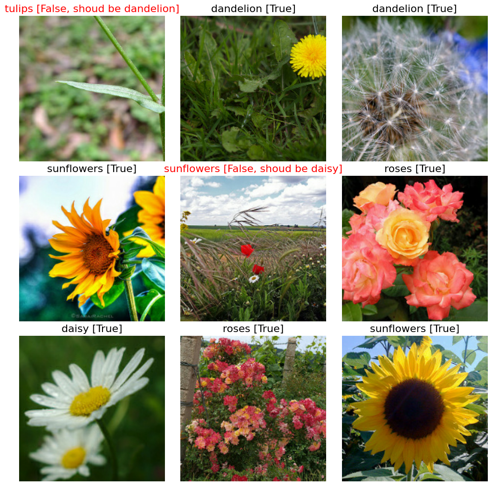
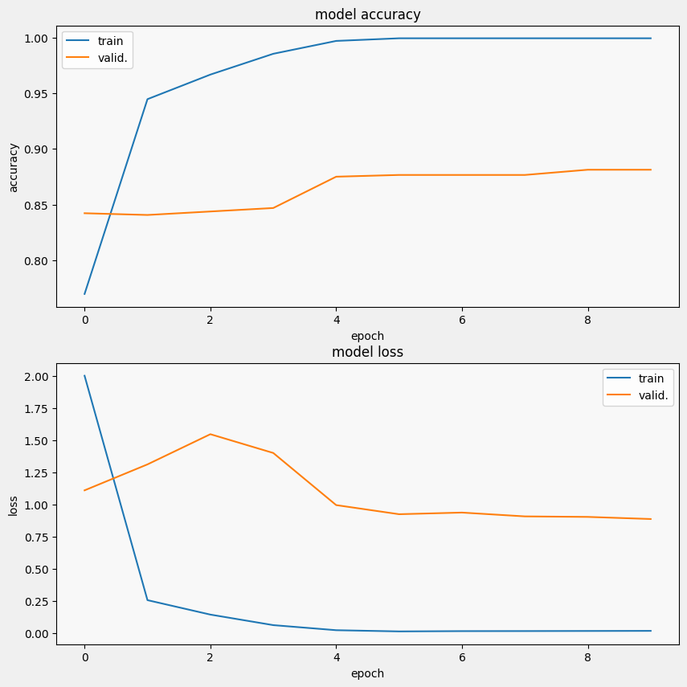
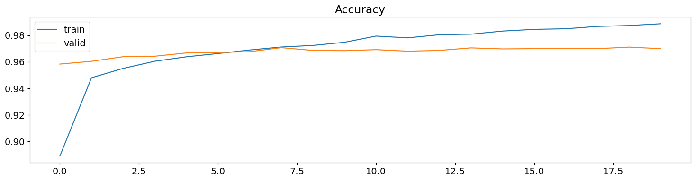

# Deep Learning Vision Lab

**Image classification with transfer learning: flowers, faces and animals**

   

## Overview

Four notebooks on **image classification with deep learning**, trained on GPU in Google Colab.
They compare pre-trained convolutional networks used as feature extractors (**transfer learning**)
and build new classification heads on top of them.

| Notebook | Dataset | Model | Result |
| --- | --- | --- | --- |
| [Part 1](https://colab.research.google.com/github/Steven-Macas/deepLearning_SAA/blob/main/deep_learning_parte1_steven.ipynb) | Flowers – 4,315 images, 5 classes | InceptionV3 + Dense(1024) | **82.3 %** test accuracy |
| [Part 2](https://colab.research.google.com/github/Steven-Macas/deepLearning_SAA/blob/main/deep_learning_parte2_steven.ipynb) | Flowers (TFRecords, 192 × 192) – daisy, dandelion, roses, sunflowers, tulips | MobileNet, MobileNetV2, VGG16, ResNet50 | **88.1 %** validation accuracy (MobileNet) |
| [Part 3](https://colab.research.google.com/github/Steven-Macas/deepLearning_SAA/blob/main/deep_learning_parte3_steven.ipynb) | CelebA – 202,599 faces, 40 attributes | InceptionV3 + data augmentation | 62.5 % test accuracy, F1 0.70 |
| [Part 4](https://colab.research.google.com/github/Steven-Macas/deepLearning_SAA/blob/main/deeepLearning_parte4_steven.ipynb) | 10 animal classes – 26,179 images (Animals-10) | InceptionV3 at 224 × 224 | **97.0 %** validation accuracy |

## Highlights

- **Part 2** compares four frozen backbones on the same data: MobileNet 88.1 %, MobileNetV2 87.2 %,
  VGG16 79.1 % and ResNet50 55.3 % validation accuracy.
- **Part 3** predicts gender from face images. Training accuracy reaches 93 % while test accuracy stays at 62.5 %:
  a clear case of overfitting, analysed in the notebook's conclusion.
- **Part 4** reaches 98.9 % training and 97.0 % validation accuracy after 20 epochs, using `ModelCheckpoint`
  to keep the best weights.

## Results

<table>
  <tr><td align="center" valign="top"> Part 2 – predictions on validation flowers</td><td align="center" valign="top"> Part 2 – MobileNet accuracy and loss</td><td align="center" valign="top"> Part 4 – InceptionV3 accuracy per epoch</td></tr>
</table>

## How to run

Open each notebook in Google Colab (links in the table) with a GPU runtime. Parts 1, 3 and 4 expect the
datasets as ZIP files in your Google Drive; part 2 reads the public TFRecords from Google Cloud Storage.

*The notebooks are written in Spanish.*

---

Made by <b>Steven Macas</b> — Data Engineer &amp; Data Analyst · <a href="https://gointy.com">gointy.com</a> · <a href="https://www.linkedin.com/in/steven-macas">LinkedIn</a> · <a href="https://github.com/Steven-Macas">GitHub</a>
